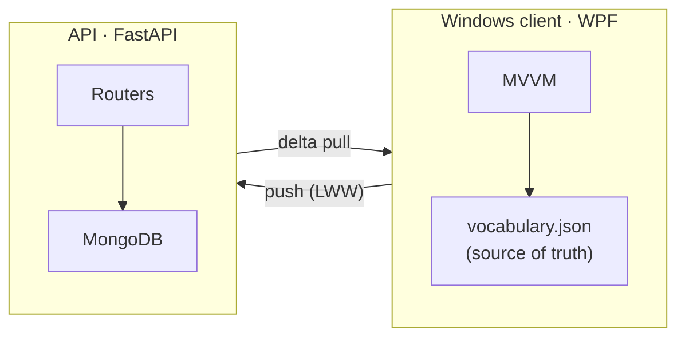

# Welcome, traveller.

<table>
  <tr>
    <td style="width: 40px; text-align: center;">🇫🇷</td>
    <td>I'm a french student at <a href="https://42nice.fr/en/homepage/">42 Nice</a> CS school.</td>
  </tr>
  <tr>
    <td style="width: 40px; text-align: center;">🔬</td>
    <td>I love science ! After studying biology at university, I decided to embark on a new journey to become a software developer.</td>
  </tr>
  <tr>
    <td style="width: 40px; text-align: center;">🎮</td>
    <td>I'm passionate about video games, roleplaying, science-fiction and all kinds of nerdy stuffs !</td>
  </tr>
</table>

# Featured projects

## 🔗 PassLink

**Self-destructing, expiring secret links**: encrypted in the browser, encrypted again at rest, gone after one read.

[**▶ Try it live**](https://passlink.arenkae.fr/) &nbsp;·&nbsp; [Source code](https://github.com/ArenKae/PassLink)

<table align="center">
  <tr>
    <td align="center" valign="middle"></td>
    <td align="center" valign="middle"></td>
    <td align="center" valign="middle"></td>
  </tr>
  <tr>
    <td align="center">1. Write a secret</td>
    <td align="center">2. Share the link or QR code</td>
    <td align="center">3. Read once, then it's gone</td>
  </tr>
</table>

- **End-to-end encryption**: the AES-256-GCM key is generated by the Web Crypto API and lives only in the URL fragment, which is never sent to the server.
- **Double encryption**: the API wraps the ciphertext in a second layer (Fernet) before it reaches MongoDB.
- **Burn on read, race-free**: reading is a single atomic `find_one_and_delete`, and a MongoDB TTL index expires unread secrets (3 minutes to 1 week) with no cleanup job.
- **Also**: file attachments (up to 10 MiB), QR code sharing, installable PWA, rate limiting, no accounts and no history.

## 📖 LexiCall

**A personal vocabulary tracker** for the words and expressions collected while reading: a category hierarchy, instant search, and a sync layer that never costs offline access.

[Source code](https://github.com/ArenKae/LexiCall)

- **Local-first**: the desktop app reads and writes a single local JSON file, so it behaves the same with or without network.
- **Bidirectional Last-Write-Wins sync**: compare-and-swap writes (`find_one_and_update` gated on `UpdatedAt`), soft-delete tombstones, delta pulls from a server-issued watermark and per-record dirty tracking.
- **In production**: a FastAPI + MongoDB backend runs on a VPS behind a reverse proxy with automatic HTTPS, and the Windows client is used daily.
- **In progress**: an Android client with React Native and Expo.

# 42 School projects

  
  
  
  
  
  
  
  
  
  
  
  
  
  
  
  

The Common Core, then the advanced projects (dr_quine, libasm) and the Piscine (rush02). Hover a badge for its name.

# GitHub Stats

  
  

# Technical skills

### Main programming languages

### Secondary programming languages

### Frameworks, Platforms and Libraries

### AI, scripting and automation

### Databases

### Mobile

### DevOps, Operating Systems and other tools

